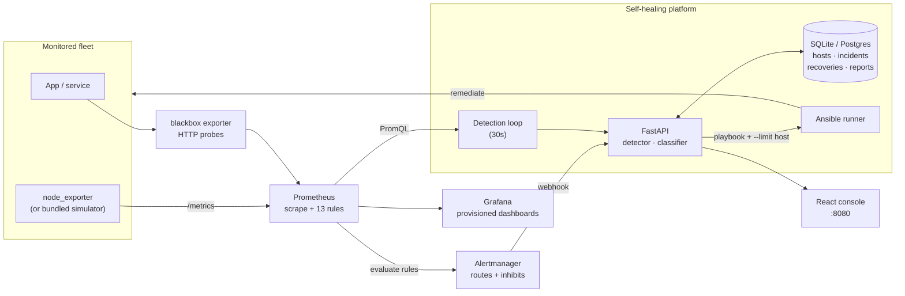

# Self-Healing Infrastructure Monitoring and Incident Management Platform

A closed-loop infrastructure operations platform: **Prometheus** collects metrics, **Alertmanager** routes
incidents, a **FastAPI** engine classifies them, **Ansible** executes remediation, and a **React** console
shows server status, alerts, incidents and every recovery action — with hard guard rails against recovery
storms.

[](https://github.com/Divakar-v-cse/Self-Healing-Infrastructure-Monitoring-and-Incident-Management-Platform/actions/workflows/ci.yml)

---

## Why this exists

Alerting is table stakes. The hard part of infrastructure operations is the *loop*: detect → classify →
decide → act → verify → learn, without letting automation thrash a broken host. This project implements
that loop with explicit, testable safeguards.

| Capability | Implementation |
| --- | --- |
| CPU, memory, disk, network, availability monitoring | node_exporter metric contract, Prometheus scrape config, blackbox probes |
| Metric collection | Prometheus 2.54 with 13 recording/alerting rules |
| Grafana dashboards | Provisioned datasource + "Self-Healing Infrastructure — Health Overview" (18 panels) |
| Critical incident routing | Alertmanager routes, grouping and 4 inhibit rules → backend webhook |
| Incident detection & classification | Rule engine with exact-match table, keyword fallback, severity normalisation |
| Automated recovery | 6 Ansible playbooks driven by the backend with per-host `--limit` targeting |
| Incident history, recovery logs, health reports | SQLite/Postgres models + `/api/v1/reports` snapshots |
| Operations dashboard | React 18 + TypeScript SPA (7 views, no chart library dependencies) |
| Configurable thresholds + loop safeguards | DB-backed thresholds, 8 safeguard rules, runtime-editable |
| Failure simulation & recovery testing | Built-in metrics simulator + chaos CLI + 85 automated tests |

---

## Architecture



**Two detection paths, one incident.** Prometheus rules give you `for:`-based persistence and route through
Alertmanager; the backend detector evaluates the same thresholds directly from the API. Both compute the same
`threshold|host|metric` fingerprint, so they converge on a single incident rather than duplicating it
(covered by `test_alert_and_detector_share_one_incident`).

### Detection → recovery loop

1. Prometheus scrapes every 10–15s; rules evaluate every 15s.
2. A breach past its `for:` duration fires an alert → Alertmanager groups and posts to
   `POST /api/v1/webhooks/alertmanager`.
3. The classifier maps the alert to `{category, severity, playbook, runbook}` and opens or refreshes an incident.
4. The detector writes metric samples, updates host status and reconciles incidents on its own 30s cycle.
5. Auto-recovery asks the safeguard engine for permission before creating a `recovery_actions` row.
6. The Ansible runner executes the playbook against `--limit <hostname>`, capturing stdout, duration and exit status.
7. When the metric returns below threshold for the settle window, the incident auto-resolves and MTTR is recorded.

---

## Quick start

### Option A — full stack with Docker Compose (recommended)

```bash
cp .env.example .env          # adjust GRAFANA_ADMIN_PASSWORD before exposing anything
docker compose up -d --build
docker compose ps
```

| Service | URL |
| --- | --- |
| Operations console | http://localhost:8080 |
| API + OpenAPI docs | http://localhost:8000/docs |
| Grafana | http://localhost:3000 |
| Prometheus | http://localhost:9090 |
| Alertmanager | http://localhost:9093 |
| Simulator + fault injection | http://localhost:9101/sim/hosts |

The stack ships with three simulated hosts (`web-01`, `api-01`, `db-01`), so the dashboard is populated
immediately and every alert path can be exercised without real machines.

### Option B — local development

```bash
# 1. backend
python -m venv .venv
.venv/Scripts/python -m pip install -r backend/requirements.txt   # Windows
# source .venv/bin/activate && pip install -r backend/requirements.txt   # Linux/macOS

# 2. simulator (terminal 2)
python simulator/app.py                       # :9101

# 3. frontend (terminal 3)
cd frontend && npm install && npm run dev     # :5173, proxies /api to :8000

# 4. backend (terminal 4)
cd backend
uvicorn app.main:app --reload --port 8000
```

Without Prometheus the backend still starts, serves the UI and API, and reports a clear error from the
detection cycle (`prometheus request failed`). Add Prometheus + Alertmanager for the full loop:

```bash
docker compose up -d prometheus alertmanager blackbox-exporter
SHIP_PROMETHEUS_URL=http://localhost:9090 uvicorn app.main:app --port 8000
```

### Option C — production-shaped run

```bash
export SHIP_ENVIRONMENT=production
export SHIP_DATABASE_URL="postgresql+psycopg://ship:***@db:5432/ship"   # keep the password in a secret store
export SHIP_ANSIBLE_DRY_RUN=false
export SHIP_ANSIBLE_PLAYBOOK_DIR=/srv/ansible/playbooks
export SHIP_ANSIBLE_INVENTORY=/srv/ansible/inventory/hosts.ini
```

Point `monitoring/prometheus/prometheus.yml` at your real node exporters (one `static_configs` entry per
host with `node` and `env` labels), and replace the simulator targets.

---

## Configuration

Every knob is environment driven (`SHIP_` prefix). The full list with comments lives in
[`.env.example`](.env.example); the operationally important ones:

| Variable | Default | Effect |
| --- | --- | --- |
| `SHIP_DATABASE_URL` | `sqlite:///./data/ship.db` | SQLite or Postgres DSN |
| `SHIP_PROMETHEUS_URL` | `http://localhost:9090` | PromQL source for the detector |
| `SHIP_ENABLE_MONITOR_LOOP` | `true` | Run the in-process detection loop |
| `SHIP_MONITOR_INTERVAL_SECONDS` | `30` | Detection cadence |
| `SHIP_RECOVERY_ENABLED` | `true` | Global kill switch (blocks even forced attempts) |
| `SHIP_ANSIBLE_DRY_RUN` | **`true`** | Validate + record the playbook command without executing |
| `SHIP_MAX_ATTEMPTS_PER_INCIDENT` | `3` | Hard stop per incident |
| `SHIP_RECOVERY_COOLDOWN_SECONDS` | `300` | Minimum gap per host + action |
| `SHIP_CIRCUIT_BREAKER_THRESHOLD` | `3` | Consecutive failures before the breaker opens |
| `SHIP_MAX_CONCURRENT_RECOVERIES` | `2` | Global fan-out limit |

Thresholds (`cpu`, `memory`, `disk`, `network`, `availability`) are stored in the database and editable from
the **Settings** view or `PATCH /api/v1/thresholds/{metric}`.

---

## Safeguards against recovery loops

`backend/app/services/safeguards.py` evaluates these rules in order — the first failure blocks the action and
the blocked attempt is persisted with its reason, so operators can see the guard working:

| # | Rule | Blocks when |
| --- | --- | --- |
| 1 | `global_switch` | `SHIP_RECOVERY_ENABLED=false` (applies even to forced attempts) |
| 2 | `maintenance_mode` | The host is in maintenance |
| 3 | `host_opt_out` | Auto-recovery disabled for that host |
| 4 | `ansible_disabled` | `SHIP_ANSIBLE_ENABLED=false` |
| 5 | `concurrency_limit` | Too many recoveries already running |
| 6 | `per_incident_limit` | `max_attempts_per_incident` reached → escalate to a human |
| 7 | `window_limit` | Too many attempts of the same action for a host inside the sliding window |
| 8 | `cooldown` | Same host + action attempted again too soon |
| 9 | `circuit_breaker` | N consecutive failures → breaker open until cooldown expires |

Demonstrated live during verification: a second manual attempt 25s after an automated one returned
`allowed=false, rule=cooldown, "retry in 275s"`.

---

## API surface

| Method | Path | Purpose |
| --- | --- | --- |
| GET | `/api/v1/health`, `/ready` | Liveness + per-dependency readiness |
| GET | `/api/v1/overview` | Dashboard aggregate (KPIs, host cards, counts) |
| GET/POST/PATCH/DELETE | `/api/v1/hosts[/{id}]` | Inventory, maintenance mode, auto-recovery opt-out |
| GET | `/api/v1/hosts/{id}/metrics?minutes=60` | Persisted metric history per host |
| GET/POST/PATCH | `/api/v1/incidents[/{id}]` | Queue, manual report, acknowledge, resolve |
| POST | `/api/v1/incidents/{id}/recover` | Trigger recovery (respects safeguards; `force` overrides cooldown) |
| GET | `/api/v1/incidents/{id}/recoveries` | Full recovery trail for an incident |
| GET | `/api/v1/alerts`, `/alerts/summary` | Alert feed and state counts |
| POST | `/api/v1/webhooks/alertmanager` | Alertmanager receiver |
| GET | `/api/v1/recoveries`, `/recoveries/stats` | Recovery log + success rate |
| GET/PATCH | `/api/v1/thresholds[/{metric}]` | Read and tune detection thresholds |
| GET/PATCH | `/api/v1/safeguards` | Read and tune loop-prevention limits |
| GET/POST | `/api/v1/reports` | Health report history / generate a snapshot |
| POST | `/api/v1/detections/run` | Run one detection cycle synchronously |
| GET/POST/DELETE | `/api/v1/simulation[/faults]` | Simulator status and fault injection |
| GET | `/metrics` | Platform KPIs in Prometheus format |

Interactive docs: <http://localhost:8000/docs>.

---

## Failure simulation

The bundled simulator speaks the node_exporter metric contract, so nothing in Prometheus or the backend is
simulator-specific.

```bash
# CLI (talks to the backend so the injection is audited)
python scripts/simulate_failure.py --host web-01 --metric cpu --value 97 --duration 300 --watch
python scripts/simulate_failure.py --host db-01  --metric disk --value 94 --duration 300
python scripts/simulate_failure.py --host api-01 --metric down --duration 120 --watch
python scripts/simulate_failure.py --clear
```

Or use the **Simulation** view in the console. A `down` fault makes the per-host scrape endpoint return
`503`, exactly like an unreachable exporter, so availability detection is exercised for real (`up == 0`).

---

## Verified behaviour

Everything below was executed on this machine (Windows 11, Python 3.12.2, Node 22.23.2) against real
Prometheus 2.54.1 and Alertmanager 0.27.0 binaries.

**Automated tests — 85 passed**

```text
$ cd backend && python -m pytest tests -q
85 passed, 1 warning in 46.53s
```

Coverage spans classification, safeguards (all rules + boundaries), detection cycles against a fake
Prometheus, the Ansible runner (dry-run, path traversal, missing inventory), and the full HTTP contract
(35 API tests).

**Configuration validation**

```text
$ promtool check rules monitoring/prometheus/rules/infrastructure.yml
SUCCESS: 13 rules found

$ promtool check config .tmp/prometheus.local.yml
SUCCESS: 1 rule files found
SUCCESS: .tmp/prometheus.local.yml is valid prometheus config file syntax

$ amtool check-config monitoring/alertmanager/alertmanager.yml
SUCCESS — global config, route, 4 inhibit rules, 2 receivers

$ docker compose config --quiet   # exit 0
```

**End-to-end incident #1 — CPU saturation (alert path)**

| Step | Observed |
| --- | --- |
| Inject 97% CPU on `web-01` | admitted by the backend, logged as a simulation event |
| Prometheus | `HighCpuUsage:pending` → `CpuSaturation:firing` after its 2m `for:` window |
| Alertmanager → backend | incident `INC-00001`, severity `critical`, `metric=cpu`, `observed=96.9998` |
| Classification | `alertname=CpuSaturation; matched exact alert rule table` |
| Recovery | attempt #1 `recover_high_cpu.yml` → `simulated` (dry-run), 0.05s, triggered by `auto` |
| Safeguard | 2nd attempt 25s later → `blocked`, `cooldown`, "retry in 275s" |
| Clear fault | incident auto-resolved, **MTTR 70.04s** |

**End-to-end incident #2 — host down (availability path)**

| Step | Observed |
| --- | --- |
| Inject `down` on `db-01` | `up{node="db-01"} = 0`, other hosts unaffected |
| Prometheus | `HostDown` fires after 1m |
| Backend | incident category `availability`, `critical`, `observed=0`, host status `down` |
| Recovery | `recover_service.yml` → `simulated` |
| Clear fault | `up=1` for all hosts, incident resolved, **MTTR 59.99s** |

**Frontend**

```text
$ cd frontend && npm run build
✓ 43 modules transformed
dist/index.html                 0.64 kB
dist/assets/index-*.css        15.43 kB
dist/assets/index-*.js        194.63 kB   (gzip 59.29 kB)
```

The backend serves the built SPA (`GET / → 200`, hashed JS asset `200`, 194 788 bytes).

**Not verified (environment limits, stated explicitly):** container image builds and `docker compose up`
were not executed because no Docker daemon was running on the build machine — only `docker compose config`
validation and the config files were checked. The Grafana dashboard JSON is provisioned and reference-checked
but was not rendered by a live Grafana instance. Live Ansible execution against real SSH hosts was not
performed (`SHIP_ANSIBLE_DRY_RUN=true` by default); the runner, command construction and failure paths are
unit-tested.

---

## Safety notes

- **Dry-run by default.** `SHIP_ANSIBLE_DRY_RUN=true` means playbooks are resolved and the exact command is
  recorded, but nothing executes. Actions are labelled `simulated` — never `success` — in the UI and metrics.
- **No secrets in the repository.** `.env` is git-ignored; `.env.example` documents every variable with
  placeholder values. Grafana's default password is `admin` only for local use and the file tells you to
  change it. Alertmanager credentials belong in `*_file` references, not inline.
- **Destructive playbook switches are opt-in.** `docker_prune_enabled`, `network_restart_enabled` and
  `allow_reboot` default to `false`.
- **Blast radius is one host.** Every playbook invocation is scoped with `--limit <hostname>`.

---

## Repository layout

```text
backend/          FastAPI app, detector, classifier, safeguards, Ansible runner, tests
  app/api/        HTTP routers (hosts, incidents, alerts, system)
  app/services/   prometheus, classifier, detector, incidents, recovery, safeguards, reports
  app/workers/    background detection loop
  tests/          85 pytest tests + fixtures (fake Prometheus, DB isolation)
frontend/         React 18 + TypeScript + Vite console (7 views, custom SVG charts)
monitoring/       Prometheus scrape + rules, Alertmanager routes, Grafana provisioning + dashboard
ansible/          6 recovery playbooks, shared role, inventory, ansible.cfg
simulator/        node_exporter-compatible metrics simulator with fault injection
scripts/          simulate_failure.py, detect_incidents.py
docs/             architecture, runbooks, testing guide
```

---

## Documentation

- [Architecture](docs/architecture.md) — component responsibilities, data model, failure modes
- [Runbooks](docs/runbooks.md) — operator procedures per alert category
- [Testing guide](docs/testing.md) — test matrix and how to reproduce the end-to-end scenarios

## License

MIT — see [LICENSE](LICENSE).
